## ¿Podemos medir miles de gravas sin medirlas una por una?

::: {.columns}
::: {.column width="55%"}
- El tamaño superficial de los clastos ayuda a interpretar la dinámica fluvial y los depósitos de crecida.
- Las mediciones manuales son útiles, pero limitan la extensión y densidad del muestreo.
- **Propuesta:** ortomosaicos UAV de resolución milimétrica + segmentación individual automatizada.
:::
::: {.column width="45%"}
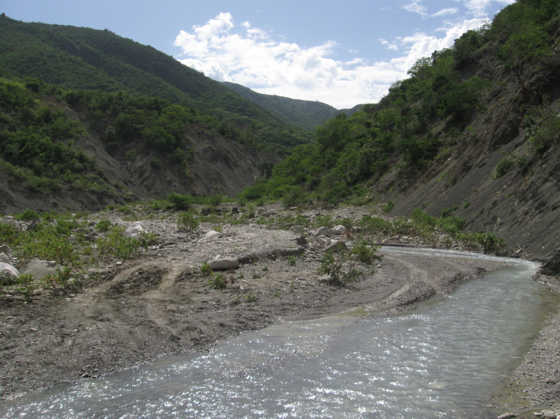{width="95%" fig-alt="Dimensiones de los clastos"}
:::
:::

## Qué medimos: ejes y granulometría superficial

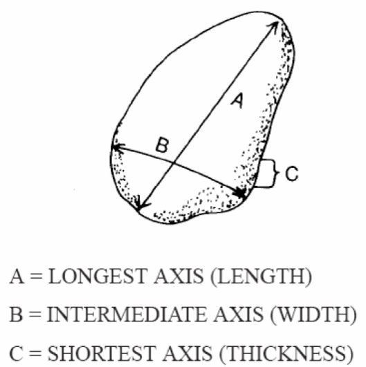{width="75%" fig-align="center"}

::: {.smaller}
La imagen permite estimar dimensiones **proyectadas** del clasto visible; no necesariamente el eje tridimensional intermedio de la clasificación granulométrica tradicional.
:::

## La distribución espacial importa

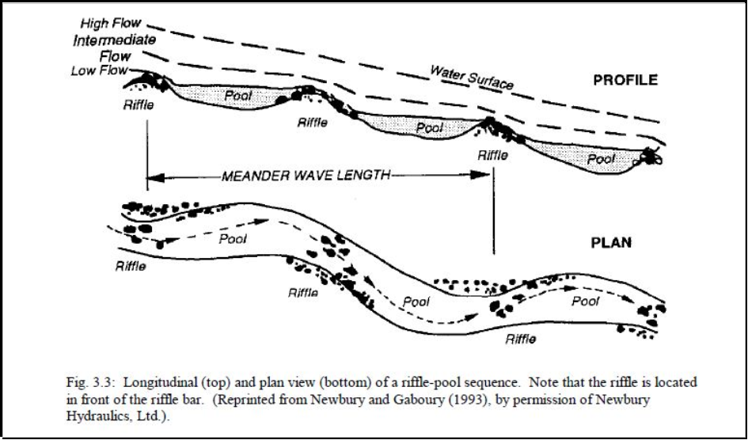{width="85%" fig-align="center"}

::: {.smaller}
La granulometría puede variar entre lecho, bancos y superficies de inundación. Figura histórica de la presentación de 2019, atribuida allí a Bunte (2001); verificar la referencia completa antes de publicar.
:::

## De la medición manual a la automatización

::: {.columns}
::: {.column width="50%"}
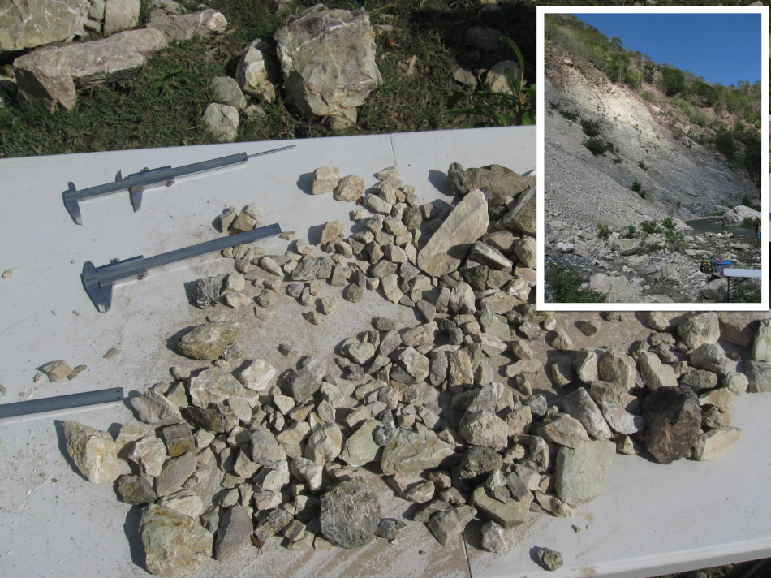{width="95%"}
:::
::: {.column width="50%"}
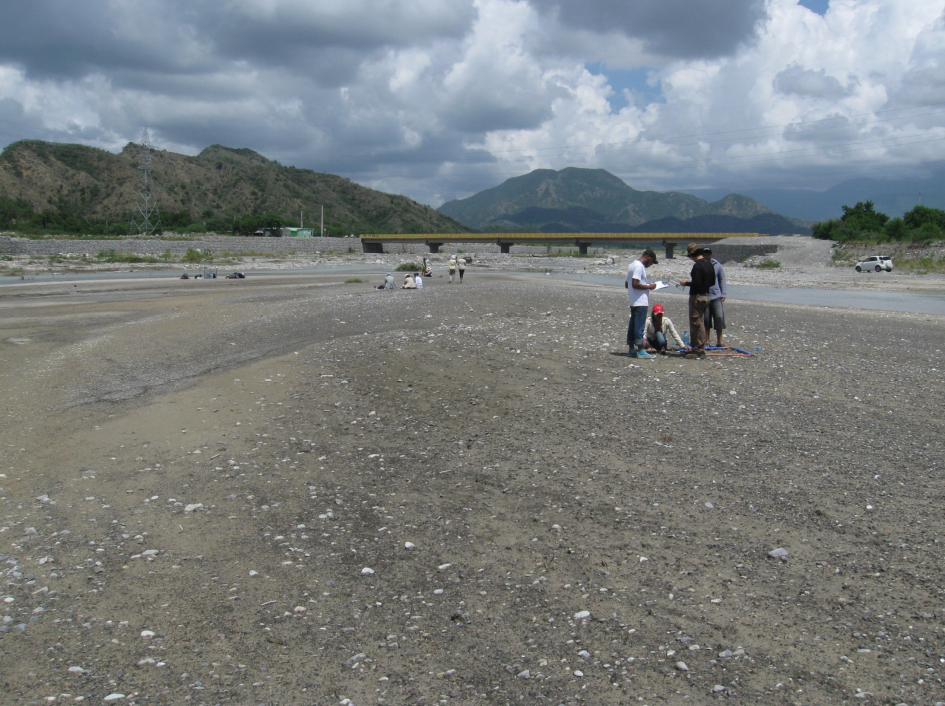{width="95%"}
:::
:::

## Objetivo

**Evaluar la viabilidad y el desempeño dimensional de una tubería de segmentación y reconstrucción de clastos superficiales a partir de un ortomosaico SfM milimétrico y SegmentEveryGrain.**

- Recuperar las mediciones manuales de referencia de 2019.
- Segmentar clastos y estimar sus dimensiones proyectadas.
- Comparar las mediciones automatizadas con las de campo.
- Explorar patrones espaciales de tamaño y forma.

## Área de estudio: río Mana

::: {.columns}
::: {.column width="50%"}
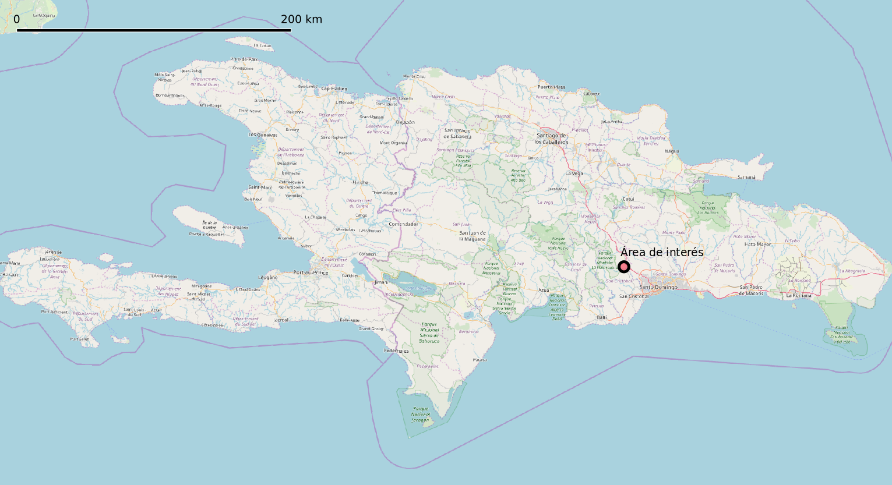{width="100%"}
:::
::: {.column width="50%"}
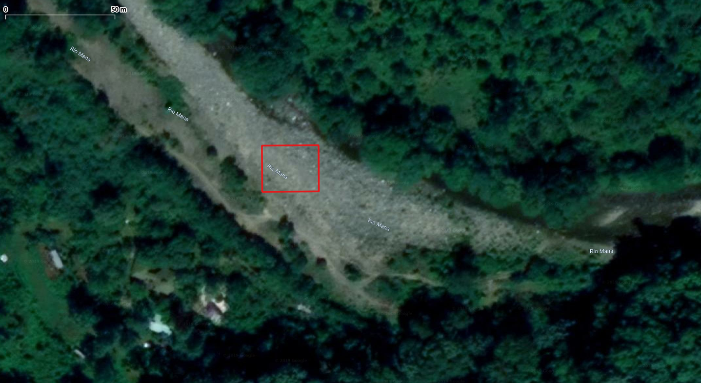{width="100%"}
:::
:::

::: {.smaller}
Banco lateral próximo a La Represa-El Cidral, Villa Altagracia, República Dominicana. Campaña de 2019; área de estudio aproximada: 10 × 15 m.
:::

## Adquisición UAV y procesamiento SfM

- **Dos visitas:** julio–septiembre de 2019.
- Vuelo preliminar con dron DJI Phantom 4 Pro, a **10 m** para evaluar escala y etiquetas (vuelo usado)
- Segunda visita: vuelos manuales a **3 m** y **5 m**, alrededor de las 10:00, sólo para pruebas.
- Vuelo bajo: **~200 fotografías**, GSD reportado **0,8 mm**.
- Procesamiento con **OpenDroneMap**: ortofoto, DSM y otros productos.

::: {.smaller}
Cifras recuperadas de la comunicación de 2019; pendientes de contraste con los metadatos y el informe ODM originales.
:::

## Dimensiones del ortomosaico: verificación de metadatos

- **Resolución espacial:** 1 mm/píxel (ortomosaico original).
- Ortofoto de **1 mm**, 24571 filas x 19904 columnas (casi 500 millones de píxeles). 10 × 15 m

::: {.columns}
::: {.column width="50%"}
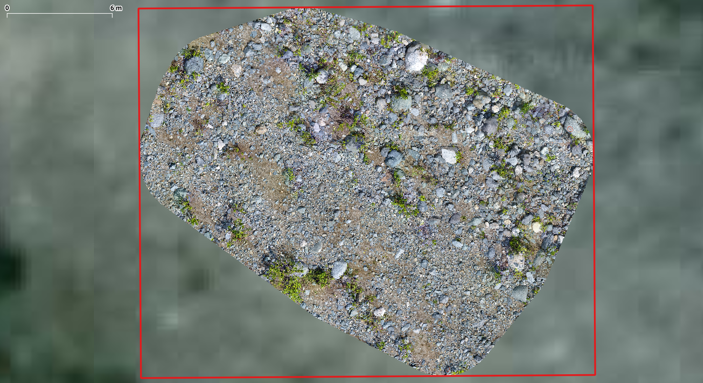{width="100%"}
:::
::: {.column width="50%"}
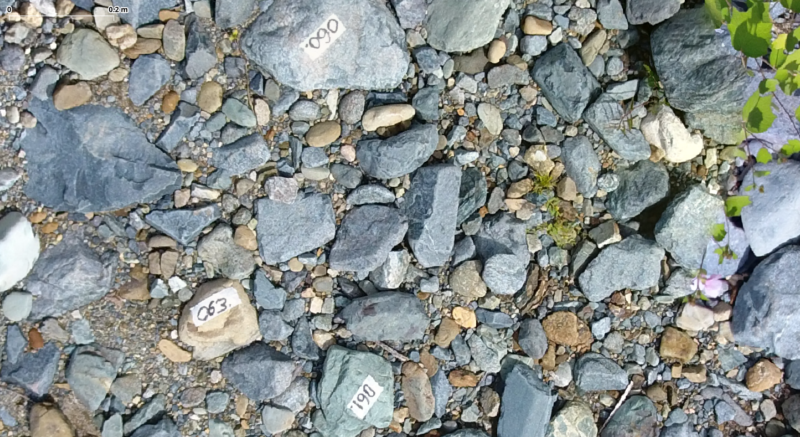{width="100%"}
:::
:::

## Flujo de trabajo fotogramétrico original

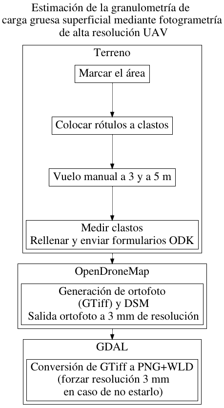{width="77%" fig-align="center"}

## Preparación y rotulación de clastos

::: {.columns}
::: {.column width="48%"}
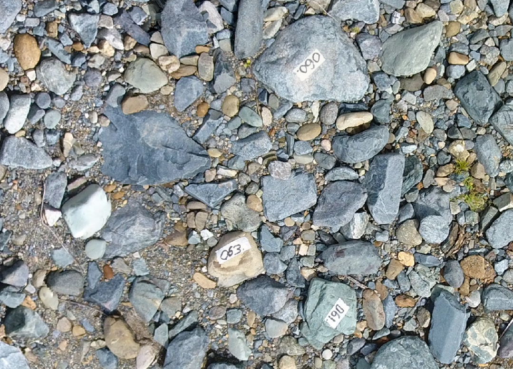{width="100%"}
:::
::: {.column width="52%"}
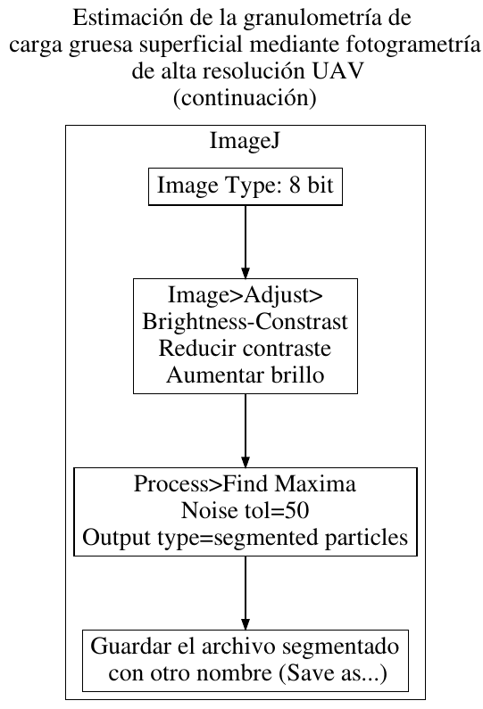{width="100%"}
:::
:::

## De las fotografías al ortomosaico

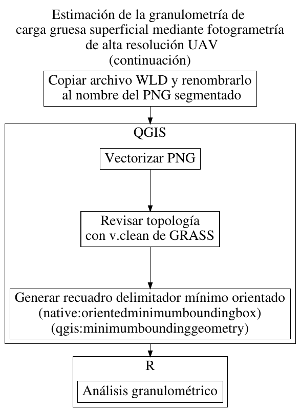{width="82%" fig-align="center"}

## Validación de campo: mediciones de referencia

- Primera visita: **100 clastos** medidos como prueba exploratoria.
- Segunda visita: **76 clastos** medidos con cinta métrica.
- Se registraron códigos individuales y dimensiones **a** y **b**.
- Los registros de campo se organizaron mediante **ODK**.

**Resultado actual:** 73 clastos de la segunda campaña quedaron vinculados inequívocamente al inventario final.

## Antecedente: segmentación semiautomática (2019)

::: {.columns}
::: {.column width="55%"}
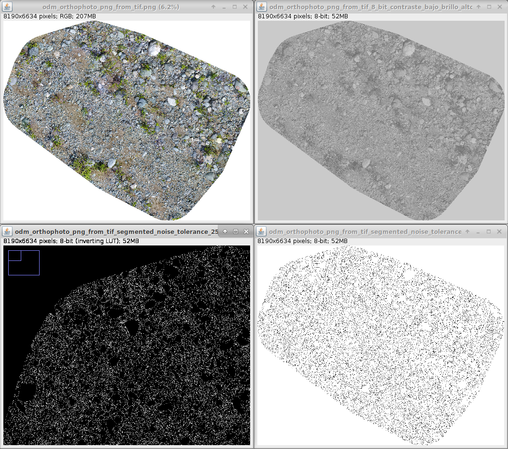{width="100%"}
:::
::: {.column width="45%"}
- Delimitación y análisis de partículas con **ImageJ**.
- Geometrías y rectángulos delimitadores procesados en **QGIS**.
- Comparación de ejes con mediciones de campo en **R**.
- Problemas identificados: falsos positivos, falsos negativos y sesgos en el eje **b**.
:::
:::

## Lo que ya habíamos anticipado en 2019

> Mejorar la segmentación mediante técnicas de *machine learning*.

- Separar clastos en contacto.
- Reducir detecciones espurias.
- Mejorar la medición de formas irregulares.
- Incorporar información espacial y, eventualmente, del DSM.

**La nueva evaluación retoma esta línea de trabajo con SegmentEveryGrain.**

## SegmentEveryGrain: herramienta utilizada

::: {.columns}
::: {.column width="65%"}
{width="100%" fig-alt="Captura del repositorio de SegmentEveryGrain en GitHub"}
:::
::: {.column width="35%"}
- **SegmentEveryGrain (SEG)**: segmentación de granos individuales a partir de imágenes.
- Repositorio de código y cuadernos de ejecución públicos.
- Aplicación a teselas del ortomosaico del río Mana.
- Revisión y fusión posterior de fragmentos en QGIS.

[Repositorio de SEG](https://github.com/zsylvester/segmenteverygrain)
:::
:::

## Segmentación SEG: cuatro ejemplos del ortomosaico

::: {style="display: grid; grid-template-columns: repeat(2, minmax(0, 1fr)); gap: 0.5rem 1rem; align-items: start;"}
::: {style="text-align: center;"}
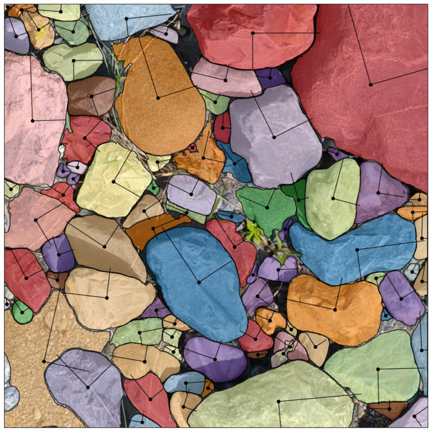{width="100%" fig-alt="Ejemplo SEG 01"}

<small>Ejemplo 01</small>
:::
::: {style="text-align: center;"}
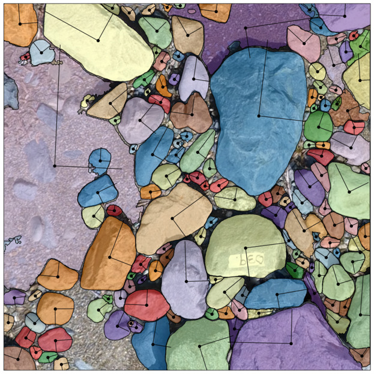{width="100%" fig-alt="Ejemplo SEG 02"}

<small>Ejemplo 02</small>
:::
::: {style="text-align: center;"}
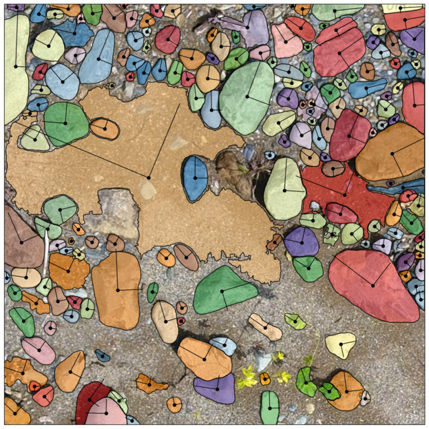{width="100%" fig-alt="Ejemplo SEG 03"}

<small>Ejemplo 03</small>
:::
::: {style="text-align: center;"}
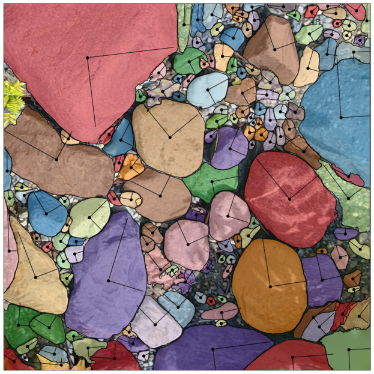{width="100%" fig-alt="Ejemplo SEG 04"}

<small>Ejemplo 04</small>
:::
:::

::: {.smaller}
Polígonos de clastos segmentados sobre la imagen; colores para distinguir instancias. Los trazos negros corresponden a la representación de ejes o referencias geométricas.
:::

## Tubería aplicada: del ortomosaico al inventario

1. Ortofoto SfM milimétrica y teselado para ejecutar **SegmentEveryGrain (SEG)**.
2. Integración de polígonos SEG en un GeoPackage georreferenciado.
3. Identificación manual de fragmentos pertenecientes a un mismo clasto en QGIS.
4. Unión geométrica de fragmentos (`st_union`) y control de geometrías.
5. Reestimación homogénea de los ejes **a** y **b** mediante momentos de área.
6. Vinculación espacial con puntos de campo y validación de dimensiones.

::: {.smaller}
Las dimensiones son ejes completos de **elipses equivalentes** en proyección 2D; no son diámetros de Feret ni ejes tridimensionales observados directamente.
:::

## Reconstrucción del inventario: resultados

::: {.columns}
::: {.column width="50%"}
### Inventario SEG

- **45 660** polígonos útiles iniciales.
- **298** grupos manuales identificados.
- **44 715** polígonos sin agrupación manual.
- **45 013** clastos finales.
- **295** entidades finales con más de un fragmento.
:::
::: {.column width="50%"}
### Control y validación

- **73** clastos emparejados con medidas de campo.
- Recalculo de ejes en todos los clastos.
- Trazabilidad de los polígonos originales.
- Sin exclusión automática por contacto con bordes de tesela.
:::
:::

::: {.smaller}
298 grupos manuales no equivale a 298 entidades multifragmento: tres grupos quedaron con un único polígono.
:::

## Distribución granulométrica superficial

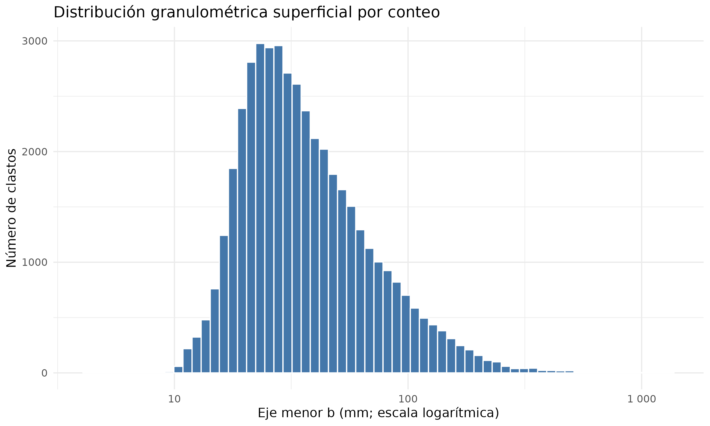{width="84%" fig-align="center"}

::: {.smaller}
Distribución **por número de clastos** del eje menor de la elipse equivalente, no distribución por masa de tamizado.
:::

## Distribución acumulada de tamaños

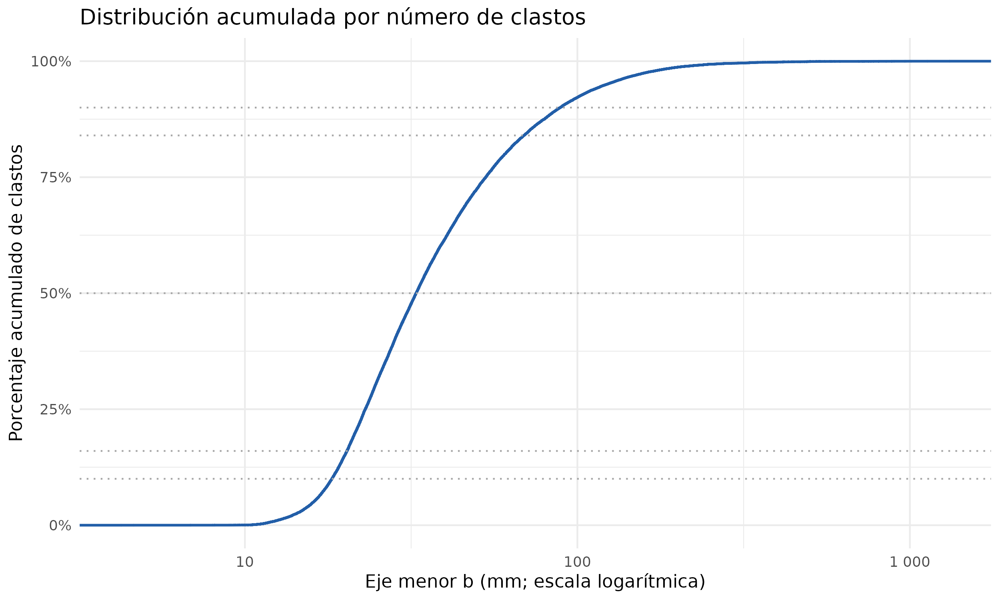{width="85%" fig-align="center"}

## Tamaños y forma de los clastos

::: {.columns}
::: {.column width="50%"}
- Mediana del eje mayor **a: 52,41 mm**.
- Mediana del eje menor **b: 32,73 mm**.
- Media de **a: 74,56 mm**.
- Media de **b: 46,60 mm**.
- Percentil 95 de **a: 198,63 mm**.
- Percentil 95 de **b: 122,25 mm**.
- Mediana de **b/a: 0,666**.
:::
::: {.column width="50%"}
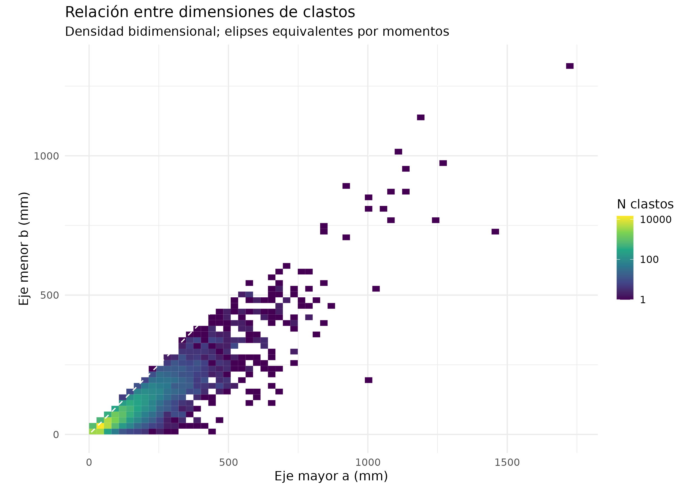{width="100%"}
:::
:::

## Relación entre tamaño y elongación

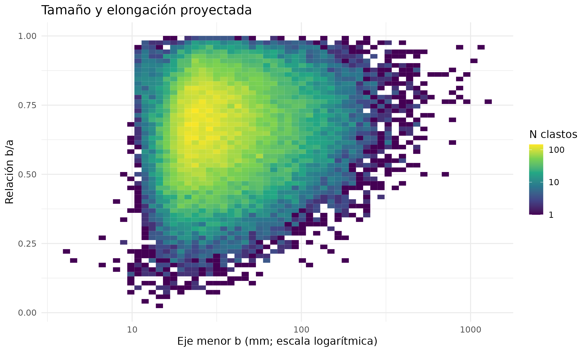{width="86%" fig-align="center"}

## Heterogeneidad espacial: tamaño mediano

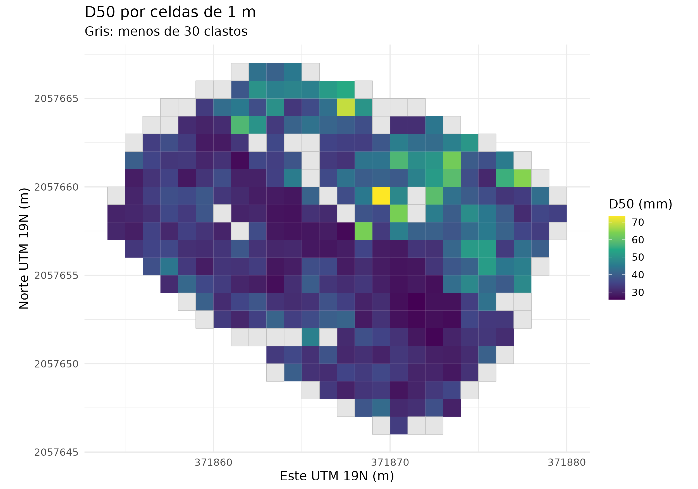{width="85%" fig-align="center"}

::: {.smaller}
Resumen espacial por celdas; el D50 representa la mediana del eje menor por número de clastos dentro de cada celda.
:::

## Validación de campo: 73 pares de clastos

| Indicador | Eje mayor (a) | Eje menor (b) |
|---|---:|---:|
| Correlación de Pearson (r) | 0,996 | 0,989 |
| R² aproximado | 0,992 | 0,978 |
| Sesgo SEG − campo | +10,30 mm | −1,62 mm |
| Error absoluto medio (MAE) | 16,20 mm | 13,10 mm |
| Raíz del error cuadrático medio (RMSE) | 23,10 mm | 28,20 mm |
| Error porcentual absoluto medio (MAPE) | 6,07 % | 5,83 % |

::: {.smaller}
Los valores son los resultados redondeados del análisis ejecutado. La correlación mide asociación, **no** por sí sola concordancia.
:::

## Asociación entre campo y SEG

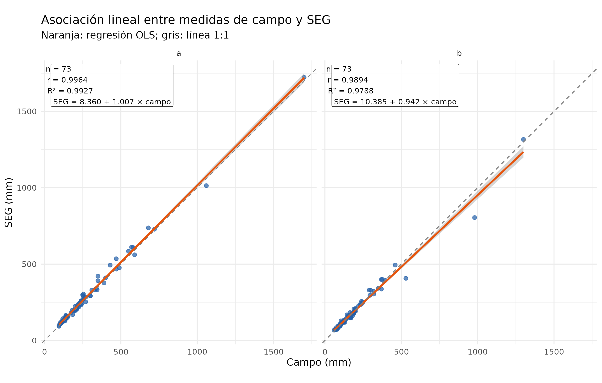{width="94%" fig-align="center"}

::: {.smaller}
Se muestran r, R², regresión OLS y referencia 1:1 por eje. Las estadísticas se calculan a partir de los pares de campo.
:::

## Concordancia: diferencias Bland–Altman

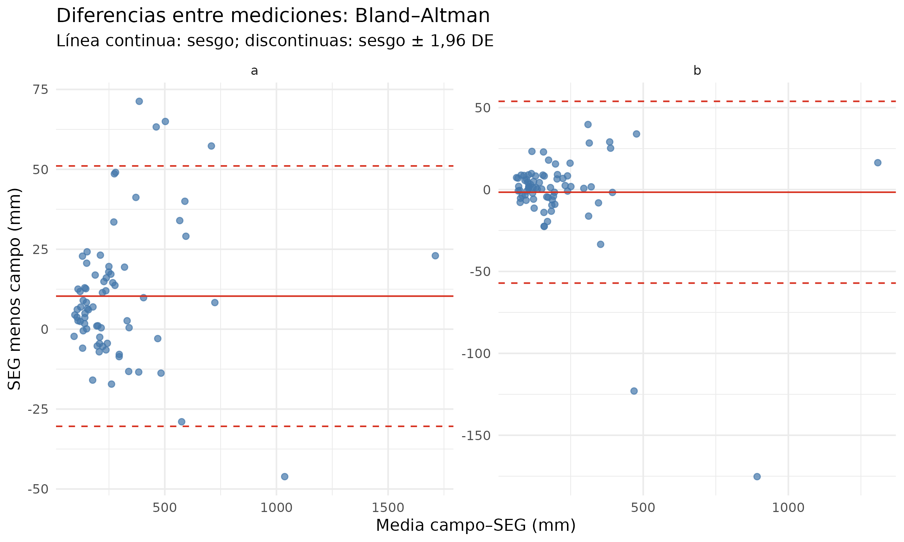{width="87%" fig-align="center"}

::: {.smaller}
La línea central indica el sesgo medio; las discontinuas, sesgo ±1,96 desviaciones estándar.
:::

## Distribución de errores porcentuales

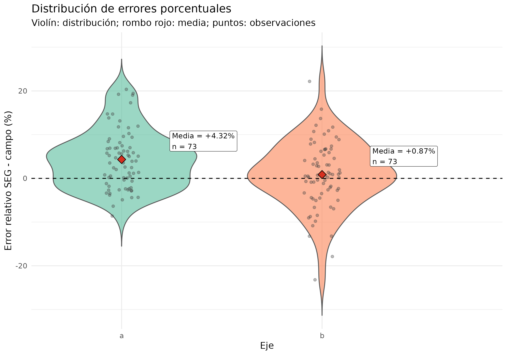{width="86%" fig-align="center"}

::: {.smaller}
Violines, observaciones individuales y medias etiquetadas; error firmado = 100 × (SEG − campo) / campo.
:::

## Interpretación y limitaciones

- Las correlaciones son muy altas (**r = 0,996** y **0,989**), pero el eje mayor muestra una **sobreestimación media**.
- El MAPE próximo al 6 % es alentador para estos **73 clastos emparejados**, sin demostrar por sí solo exactitud para todo el inventario.
- Los ejes de elipse equivalente se obtienen de la silueta 2D y no son idénticos a las medidas físicas de campo.
- La segmentación sigue siendo sensible a sombras, oclusión, contacto entre clastos y delimitaciones ambiguas.
- Los resultados de tamaño corresponden a **frecuencias de clastos visibles**, no a una granulometría por masa.

## De 2019 a 2026: ¿qué hemos conseguido?

| Dimensión | 2019: ImageJ+QGIS | 2026: SEG |
|---|---|---|
| Detección | 11 630 rectángulos | 45 013 clastos finales |
| Geometría | Rectángulos delimitadores | Polígonos individuales |
| Medición | Dimensiones de rectángulos | Ejes de elipse equivalente |
| Validación | Comparaciones y pruebas *t* | 73 pares; r, MAE, RMSE, MAPE |
| Concordancia | No evaluada con Bland–Altman | Sesgo y límites de concordancia |
| Análisis espacial | Geoprocesamiento en SIG | Distribuciones y mapas de D50 |

::: {.smaller}
Las cantidades de objetos no son directamente comparables:
se utilizaron diferentes criterios de segmentación y geometría.
:::

**Avance principal:** de una aproximación semiautomática
a un inventario de clastos individualizados, georreferenciados,
trazables y sometidos a una evaluación de concordancia.

## Conclusiones

- La combinación **SfM + SegmentEveryGrain + revisión manual** permitió reconstruir **45 013 clastos** en un banco fluvial.
- Se obtuvo un inventario georreferenciado y trazable con dimensiones proyectadas calculadas de forma uniforme.
- La validación con **73 clastos** evidenció asociación lineal muy elevada entre campo y SEG, con errores porcentuales absolutos medios cercanos al **6 %**.
- La metodología ofrece una vía para caracterizar la **granulometría superficial por conteo**, con la precaución de examinar sesgos y representatividad.
- Respecto al trabajo de 2019, **se materializó la propuesta de incorporar aprendizaje automático**, obteniendo geometrías individuales y una evaluación más completa de los errores de medición.

## Referencias y recursos

- Sylvester, Z. [SegmentEveryGrain: repositorio y cuadernos](https://github.com/zsylvester/segmenteverygrain).
- [Cuaderno original para Google Colab](https://github.com/zsylvester/segmenteverygrain/blob/main/notebooks/Segment_every_grain_colab.ipynb).
- Martínez Batlle, J. R. (2019). *Estimación de la granulometría de carga gruesa superficial mediante fotografías de alta resolución tomadas por UAV*. XVIII Jornada de Investigación Científica, UASD.
- Bunte (2001): completar referencia bibliográfica de la presentación original.
